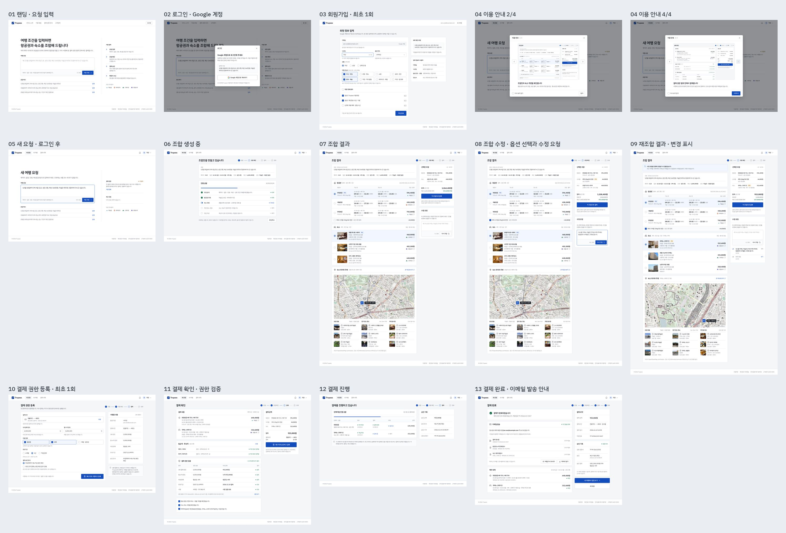

# Trupass 화면 설계

여행 요청 한 문장으로 항공권과 숙소를 조합하고, 미리 서명해 둔 결제 권한 범위 안에서 결제까지 끝내는 흐름의 화면 설계다.
데스크톱 1440 · 태블릿 834 · 모바일 390 세 폭을 하나의 반응형 HTML/CSS 소스로 만들고, 같은 소스에서 피그마용 산출물을 뽑는다.



태블릿은 [`preview/sheet-tablet.jpg`](preview/sheet-tablet.jpg), 모바일은 [`preview/sheet-mobile.jpg`](preview/sheet-mobile.jpg)에 있다.

## 화면 흐름

| 번호 | 화면 | 핵심 |
| --- | --- | --- |
| 01 | 랜딩 · 요청 입력 | 스크롤 없이 첫 화면에서 요청을 입력한다. 오른쪽에 이용 절차 4단계와 요금 조회 출처 |
| 02 | 로그인 · Google 계정 | `[조합 요청]`을 누르면 뜨는 모달. 입력한 요청을 다시 보여 주고 Google 계정으로 로그인 |
| 03 | 회원가입 · 최초 1회 | 이메일(확인만) → 닉네임 → 출생 연도 → 성별(선택) → 여행 관심사(최대 3개) → 약관 |
| 04 | 이용 안내 | 좌우 버튼으로 넘기는 4장짜리 모달. 그림은 실제 화면 캡처, 하단에 "다시 보지 않기" |
| 05 | 새 요청 · 로그인 후 | 로그인 전에 적은 요청이 그대로 들어 있다. 결제 권한 상태와 최근 요청 |
| 06 | 조합 생성 중 | 요청 분석 → 항공권 조회 → 숙소 조회 → 주변 장소 조회 → 조합 계산, 출처별 진행 상황 |
| 07 | 조합 결과 | 항공편·숙소 선택표(요금 출처 로고 + 링크), 숙소 위치 지도, 주변 장소 세 묶음(요청 맞춤 · 많이 찾는 명소 · 주변 음식점)과 사진 |
| 08 | 조합 수정 | 옵션(수하물 변경)을 체크하면 합계가 바로 바뀌고, 선택지에 없는 변경은 수정 요청 문장으로 보낸다 |
| 09 | 재조합 결과 | 수정 요청을 반영한 v2. 바뀐 것과 유지한 것을 맨 위에 적고 바뀐 항목에 "변경" 표식 |
| 10 | 결제 권한 등록 · 최초 1회 | 한도·허용 항목·유효기간·승인 방식을 정하고 패스키로 서명 (가정한 보조 화면, 아래 참고) |
| 11 | 결제 확인 · 권한 검증 | 서명해 둔 권한과 이번 결제를 항목별로 대조해 보여 주고 패스키 승인 한 번으로 결제 |
| 12 | 결제 진행 | 판매자마다 확보 → 결제 → 확정. 한 곳이라도 실패하면 전부 취소 |
| 13 | 결제 완료 | 예약번호와 결제 요약, 영수증·확정서가 등록한 이메일로 발송됐음을 문서별로 표시 |

`00 디자인 기준`은 색·글꼴·모서리·아이콘·컴포넌트를 한 장에 모은 화면이다.

## 이전 시안에서 걷어낸 것

기존 시안(피그마의 모바일 6화면과 `docs/design/src` 초안)에서 "AI가 만든 티"가 나던 요소를 정리하고, 결제를 다루는 서비스에 맞게 차분한 업무용 톤으로 바꿨다.

| 이전 | 지금 | 이유 |
| --- | --- | --- |
| Tailwind 기본 팔레트 그대로 (`#1D4ED8`, `#0F172A`, `#F8FAFC` …) | OKLCH에서 직접 뽑은 중립·브랜드 램프 (`src/tokens.css`) | 기본 팔레트는 어디서나 본 색이라 브랜드로 읽히지 않는다 |
| 둥근 알약 배지, 아이콘을 넣은 색 타일, 옅은 색 안내 박스 남발 | 상태는 점 + 글자, 구분은 모서리 2px 표식 | 색 면적이 많을수록 정작 봐야 할 상태가 묻힌다 |
| 카드 반경 12~16px, 넓은 그림자 | 컨트롤 4 · 패널 6 · 모달 8, 그림자는 모달과 지도 핀에만 | 표와 숫자가 많은 화면은 단정한 모서리가 밀도를 감당한다 |
| 장식용 고정폭 글꼴, 대문자 자간 라벨(`AP2 · AI TRAVEL PACKAGE`, `MANDATE`) | IBM Plex Sans KR 한 벌, 숫자는 tabular | 고정폭·대문자 라벨은 정보가 아니라 분위기였다 |
| 보딩패스 모양 카드(절취선·스텁), 가짜 브라우저 창 프레임 | 행 + 라디오로 된 선택표, 실제 화면 캡처 | 비교·선택이 목적이면 표가 빠르다 |
| 투톤 워드마크 + 아이콘 라이브러리의 비행기를 붙인 로고 | 체크의 긴 획이 이륙 방향으로 이어지는 단순한 마크, 한 가지 색 워드마크 | 16px에서도 읽히고 다른 아이콘 세트와 겹치지 않는다 |
| "말 한 번으로 떠나고, 결제는 서명 한 번." 같은 구호형 문구 | "~합니다" 체의 기능 문구, 숫자·날짜·출처를 그대로 표기 | 무엇을 하는 화면인지가 문구에서 바로 보여야 한다 |
| 아이콘: Lucide | 아이콘: IBM Carbon | 글꼴(Plex)과 같은 체계라 선 굵기와 비례가 맞는다 |

로고는 제안안이다. 기존 마크를 유지하려면 `src/lib/ui.mjs`의 `mark()` 한 곳만 바꾸면 된다.

## 디자인 기준

- 색: 중립(hue 258) 한 벌 + 브랜드(hue 262) 한 벌. 주 버튼·링크·선택 상태만 브랜드색을 쓴다. 상태색(완료·주의·실패)은 글자와 점에만 쓴다.
- 글꼴: IBM Plex Sans KR 400 / 500 / 600. 본문 14/22, 보조 13/20, 캡션 12/18, 제목 16·18·24, 랜딩 36.
- 간격: 4의 배수. 패널 안쪽 20, 패널 사이 16, 페이지 좌우 32(모바일 16).
- 반응형: 데스크톱 ≥1200 / 태블릿 768–1199 / 모바일 ≤767.
  - 데스크톱은 본문 + 오른쪽 레일(선택한 조합·결제 금액) 2단, 태블릿·모바일은 1단으로 쌓고 결제 버튼을 하단 고정 바로 옮긴다.
  - 선택표의 행은 모바일에서 줄바꿈되어 "항공사·요금 / 가는 편 / 오는 편" 순으로 쌓인다.
  - 모달은 모바일에서 하단 시트가 된다.
- 레이아웃 규칙: 모든 요소를 flex(row/column) + gap + padding으로만 짠다. margin·grid·가상요소로 화면을 그리지 않는다. 피그마 오토레이아웃과 1:1로 대응시키기 위한 규칙이므로 화면을 고칠 때도 지켜야 한다.

## 폴더

```
docs/design
├─ src/                 화면 소스
│  ├─ tokens.css        색·글꼴·간격 토큰, 반응형 표시 규칙
│  ├─ components.css    버튼·입력·패널·상태·모달
│  ├─ screens.css       화면별 스타일
│  ├─ lib/              아이콘(Carbon), 마크업 헬퍼, 목업 데이터
│  ├─ screens/          화면 하나당 모듈 하나
│  └─ build.mjs         dist/ 생성
├─ assets/              지도·사진·이용 안내 캡처, CREDITS.md
├─ preview/             폭별 한눈에 보기(JPEG). 화면별 PNG는 렌더로 생성
├─ figma/plugin/        피그마 플러그인(오토레이아웃 버전 생성기)
└─ tools/               렌더, 에셋 수집, 피그마 변환·검증
```

## 실행

```bash
cd docs/design
node src/build.mjs          # dist/index.html 과 dist/screens/*.html 생성 (의존성 없음)
```

`dist/index.html`을 브라우저로 열고 창 폭을 바꿔 가며 본다.

화면을 PNG로 찍거나 피그마 산출물을 다시 만들 때만 Playwright가 필요하다. 렌더는 로컬에 설치된 IBM Plex Sans KR을 쓴다.

```bash
npm i                       # playwright
npx playwright install chromium
npm run render              # preview/{d,t,m}/*.png
npm run shots               # 이용 안내에 넣는 캡처를 실제 화면에서 다시 뜬다
npm run figma               # 추출 → SVG(검증) → 오토레이아웃 시뮬레이션 → 플러그인 생성 → 모의 실행
```

## 피그마 반영

피그마 MCP의 읽기·쓰기 도구가 Starter 플랜 월 한도에 걸려 있어서, 한도와 무관한 두 경로로 넣었다.

### 1. 파일에 올라가 있는 것 (편집 가능한 벡터)

화면을 SVG로 바꿔 피그마 파일에 올렸다. 글자는 살아 있는 텍스트, 아이콘은 벡터, 사진·지도는 이미지 채움이며 레이어 이름이 붙어 있다. 오토레이아웃은 없다(절대 좌표).

| 보드 | 링크 |
| --- | --- |
| Trupass 디자인 기준 | https://www.figma.com/design/zew1dl0LBSUY6N2QHFZmUT/Trupass?node-id=43-161 |
| Trupass 리디자인 · Desktop 1440 (14화면) | https://www.figma.com/design/zew1dl0LBSUY6N2QHFZmUT/Trupass?node-id=43-1388 |
| Trupass 리디자인 · Tablet 834 (13화면) | https://www.figma.com/design/zew1dl0LBSUY6N2QHFZmUT/Trupass?node-id=43-5250 |
| Trupass 리디자인 · Mobile 390 (13화면) | https://www.figma.com/design/zew1dl0LBSUY6N2QHFZmUT/Trupass?node-id=43-8929 |
| Trupass 로고 | https://www.figma.com/design/zew1dl0LBSUY6N2QHFZmUT/Trupass?node-id=42-161 |

- 보드 하나가 프레임 하나이고 화면들은 그 안에 들어 있다. 화면을 낱개 프레임으로 쓰려면 보드를 선택하고 그룹 해제(⌘/Ctrl+Shift+G)한다.
- 올린 위치는 피그마가 자동으로 정했다. 기존 프레임과 겹쳐 있으면 보드째 옮기면 된다.
- 업로드 시점에는 MCP 읽기 도구가 막혀 있어 피그마 안에서의 렌더 결과를 직접 확인하지 못했다. 올리기 전 SVG를 브라우저로 다시 그려 원본 화면과 비교한 결과는 화면별 픽셀 차이 0.2% 이하였다.

### 2. 오토레이아웃 버전 (플러그인을 한 번 실행)

`figma/plugin`은 같은 화면을 오토레이아웃 프레임, 색 변수(`Trupass / Color`), 텍스트 스타일로 짓는 생성기다. MCP를 쓰지 않는다.

1. 피그마 데스크톱 앱에서 Trupass 파일을 연다.
2. 메뉴 `Plugins › Development › Import plugin from manifest…`에서 `docs/design/figma/plugin/manifest.json`을 고른다.
3. `Plugins › Development › Trupass 화면 생성`을 실행한다. 41개 화면을 짓는 데 수십 초가 걸린다.

- 새 페이지 `Trupass 리디자인 (오토레이아웃)`에 놓는다. 무료 플랜의 페이지 수 제한으로 새 페이지를 만들 수 없으면 현재 페이지의 오른쪽 빈 자리에 놓는다.
- 브라우저만 쓰는 경우: 파일을 연 상태에서 개발자 도구 콘솔에 `figma`를 입력해 객체가 보이면, `figma/plugin/code.js` 전체를 붙여 넣어 실행해도 같은 결과가 나온다.
- 글꼴은 IBM Plex Sans KR(구글 폰트, 피그마 기본 제공)을 쓴다. 없으면 다른 글꼴로 대신하고 콘솔에 알린다.
- 여러 줄 문단은 브라우저의 줄바꿈 위치를 그대로 옮겼다(문단 안 줄바꿈). 피그마가 한글을 글자 단위로 끊기 때문이다. 문구를 고칠 때는 줄바꿈을 지우고 다시 넣으면 된다.
- 이 생성기는 실제 피그마에서 실행해 보지 못했다. 대신 세 가지로 검증했다.
  - 공식 타입 정의(`@figma/plugin-typings`)로 타입 검사
  - 모의 Figma 런타임에서 끝까지 실행 (`tools/figma/mock-run.mjs`): 글꼴을 싣기 전 글자 입력, 오토레이아웃 밖 FILL/HUG, 색 범위 같은 호출 규칙 위반 0건
  - 오토레이아웃 규칙만으로 다시 그려 원본과 비교 (`tools/figma/sim.mjs`): 화면별 픽셀 차이 0.17% 이하
- 실행했는데 오류가 나거나 모양이 어긋나면 콘솔의 `[Trupass] 알림` 내용을 알려 주면 고칠 수 있다.

두 버전이 모두 필요하지는 않다. 플러그인 버전이 잘 나오면 1번의 보드는 지워도 된다.

## 가정과 확인이 필요한 것

- 요금 조회 출처(하늘길·에어모아·스테이온·호텔나루)와 항공사·숙소·음식점 이름은 가상이다. 연동할 API가 정해지면 `src/lib/ui.mjs`의 출처 로고와 `src/lib/data.mjs`를 바꾼다. 미술관·명소는 실제 장소이고 거리는 좌표로 계산했다.
- 10 결제 권한 등록은 요청에 없던 화면이다. "회원별로 사전 서명된 증명서와 설정된 권한"이 있으려면 처음 한 번은 등록해야 하므로 첫 결제 직전에 두었다. 가입 단계나 설정으로 옮겨도 화면은 그대로 쓸 수 있다.
- 11 결제 확인의 탑승객·투숙객 정보는 요약만 두었다. 여권 정보 입력 화면은 범위 밖이다.
- 나이는 출생 연도로 받는다. 연령대 선택으로 바꾸려면 `03-signup.mjs`의 필드 하나만 바꾸면 된다.
- 권한 초과, 요금 변동, 재고 마감, 결제 실패 같은 예외 화면은 이번 범위에 없다.
- Google 로그인 버튼은 실제 구현에서 Google의 공식 버튼 규격을 따라야 한다.

## 출처

지도(OpenStreetMap), 사진(Wikimedia Commons), 아이콘(IBM Carbon), 글꼴(IBM Plex Sans KR)의 출처와 라이선스는 [`assets/CREDITS.md`](assets/CREDITS.md)에 있다.
